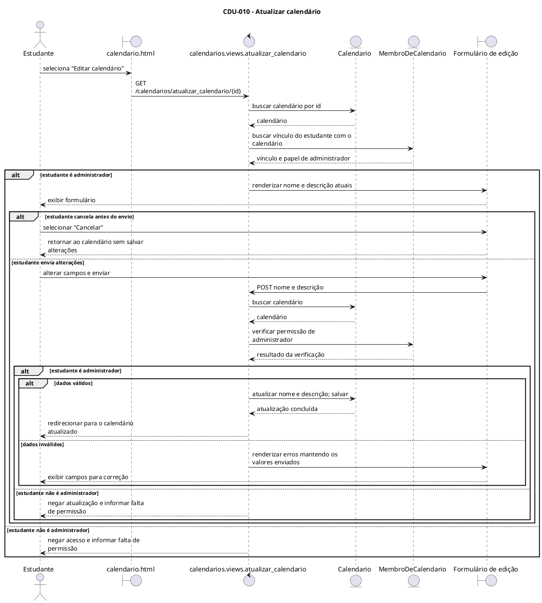
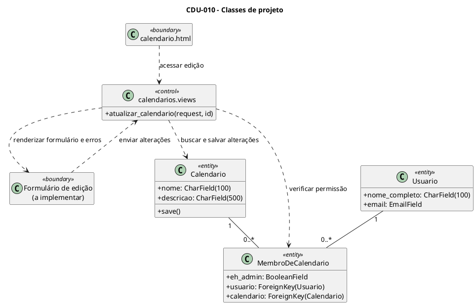

# CDU-010 — Códigos dos diagramas

Os diagramas abaixo representam o fluxo especificado no [CDU-010](cdu_010.md).
O formulário de edição é parte do projeto do caso de uso e ainda precisa ser
implementado.

## Diagrama de sequência

## Diagrama de classes de projeto

     