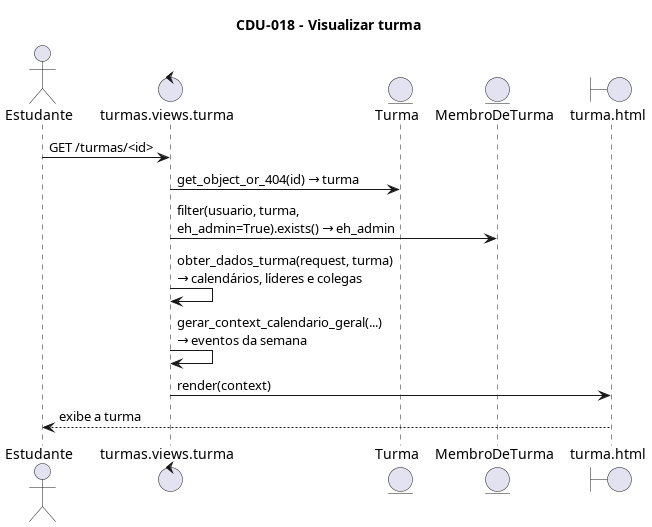
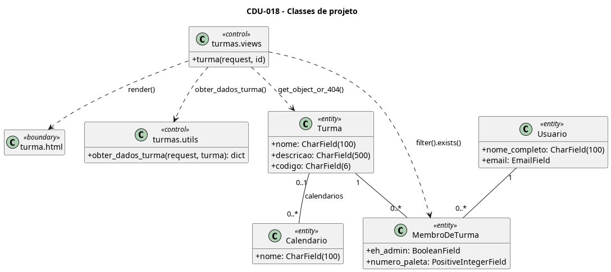

# CDU-018 Visualizar turma

- **Ator principal**: Estudante
- **Atores secundários**: Nenhum
- **Descrição**: O estudante visualiza as informações de uma turma.
- **Pré-condição**: O estudante está autenticado no sistema e é membro da turma.
- **Pós-Condição**: Nenhuma.

## Fluxo Principal

|                        Ações do ator                        |                                                                Ações do sistema                                                                |
| :-----------------------------------------------------------: | :-----------------------------------------------------------------------------------------------------------------------------------------------: |
| 1 - O usuário seleciona no menu lateral uma opção de turma | 2 - Sistema exibe os dados principais da turma e três abas: eventos, calendário e membros. Se o usuário for admin, mostra o código de turma. |

## Diagrama de Interação (Sequência ou Comunicação)

## Diagrama de Classes de Projeto

