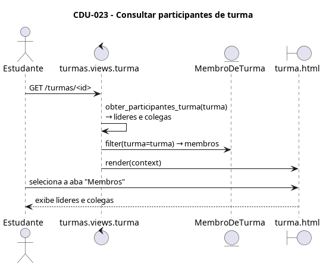
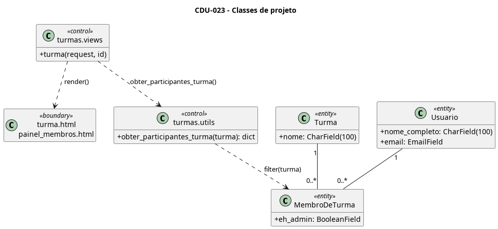

# CDU-023 Consultar participantes de turma

- **Ator principal**: Estudante
- **Atores secundários**: Nenhum
- **Descrição**: O estudante consulta os participantes de uma turma.
- **Pré-condição**: O estudante está autenticado no sistema e é membro da turma.
- **Pós-Condição**: Nenhuma.

## Fluxo Principal

|                       Ações do ator                       |                                           Ações do sistema                                           |
| :---------------------------------------------------------: | :----------------------------------------------------------------------------------------------------: |
|          1 - Estudante acessa a página da turma.          |                       2 - Sistema exibe a página da turma com a aba "Eventos" ativa.                       |
|              3 - Estudante seleciona a aba "Membros".              | 4 - Sistema exibe os participantes da turma separados em "Líderes" (administradores) e "Colegas de turma", com o nome de cada um. |

## Fluxo Alternativo I - Categoria sem participantes

|  Ações do ator  |                                       Ações do sistema                                       |
| :-------------: | :--------------------------------------------------------------------------------------------: |
|                 | 4.1 - Sistema exibe a categoria ("Líderes" ou "Colegas de turma") sem participantes listados. |

## Fluxo Alternativo II - Estudante não é membro da turma

|                         Ações do ator                         |                           Ações do sistema                           |
| :-------------------------------------------------------------: | :--------------------------------------------------------------------: |
| 1.1 - Estudante tenta acessar a página de uma turma da qual não é membro. | 1.2 - Sistema informa que a turma não foi encontrada (erro 404). |

## Pontos em aberto

- O ícone de e-mail exibido ao lado de cada participante deve abrir o cliente de e-mail (`mailto:`) ou apenas exibir o endereço?
- A categoria sem participantes deve exibir uma mensagem (e.g., "Nenhum colega na turma") ou ser ocultada?
- Hoje, um estudante que não é membro e acessa a URL da turma recebe erro 500; o fluxo alternativo II propõe tratar como 404.

> Obs. as seções a seguir apenas serão utilizadas na segunda unidade do PDSWeb (segundo orientações do gerente do projeto).

## Diagrama de Interação (Sequência ou Comunicação)

## Diagrama de Classes de Projeto

