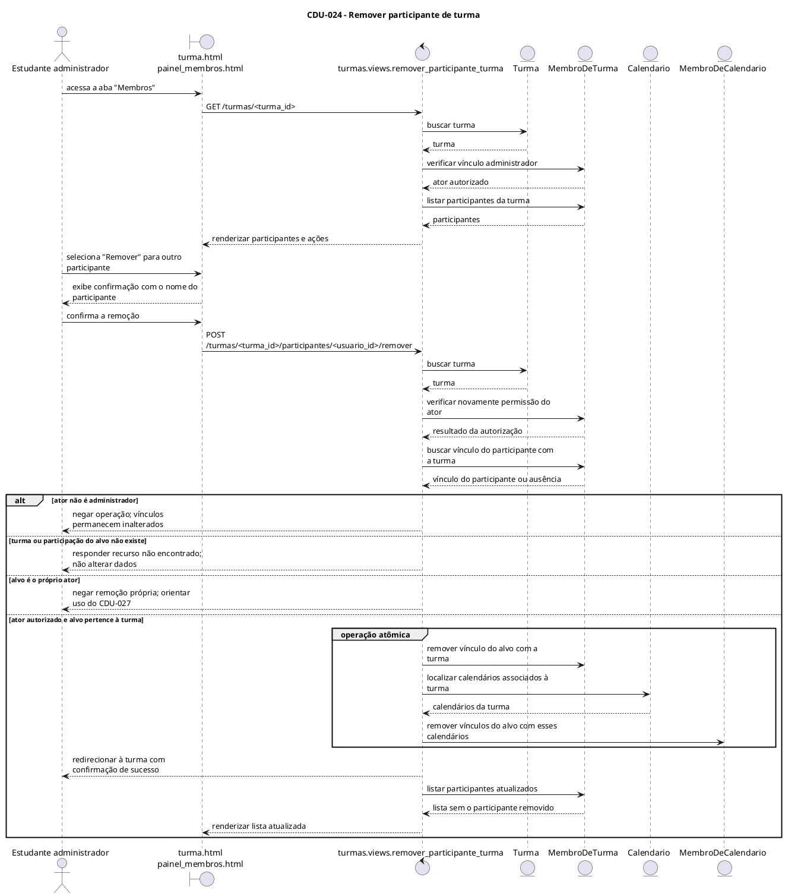
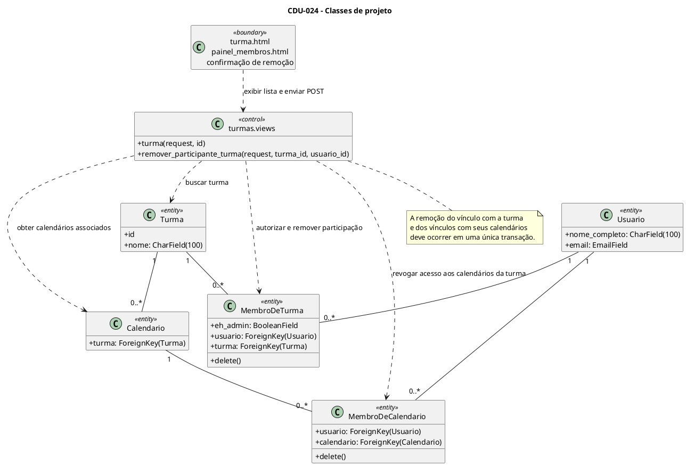

# CDU-024 — Códigos dos diagramas

Os diagramas abaixo descrevem a proposta de interação e de classes de projeto
para o [CDU-024](cdu_024_completo.md). Os códigos podem ser copiados para um
renderizador PlantUML.

## Diagrama de sequência

## Diagrama de classes de projeto

