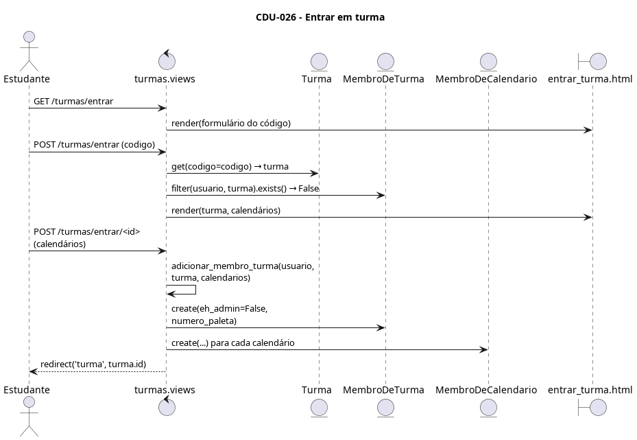
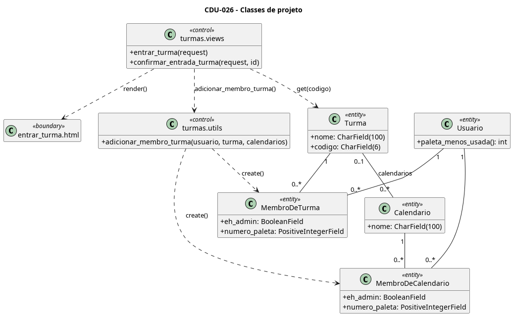

# CDU-026 Entrar em turma

- **Ator principal**: Estudante
- **Atores secundários**: Nenhum
- **Descrição**: O estudante ingressa em uma turma.
- **Pré-condição**: O estudante está autenticado no sistema e possui o código da turma.
- **Pós-Condição**: O estudante está associado à turma.

## Fluxo Principal

|                                   Ações do ator                                   |                                                                       Ações do sistema                                                                       |
| :---------------------------------------------------------------------------------: | :------------------------------------------------------------------------------------------------------------------------------------------------------------: |
|                  1 - Estudante acessa a opção "Entrar em turma".                  |                                               2 - Sistema exibe o formulário para informar o código da turma.                                               |
|                      3 - Estudante informa o código e envia.                      |                               4 - Sistema localiza a turma e exibe o nome dela e a lista de calendários (disciplinas) da turma.                               |
| 5 - Estudante seleciona os calendários que deseja acompanhar e confirma a entrada. | 6 - Sistema associa o estudante à turma como colega (não administrador) e aos calendários selecionados, e exibe a página da turma com mensagem de sucesso. |

## Fluxo Alternativo I - Código inválido

|                            Ações do ator                            |                            Ações do sistema                            |
| :-------------------------------------------------------------------: | :----------------------------------------------------------------------: |
| 3.1 - Estudante informa um código que não pertence a nenhuma turma. | 3.2 - Sistema exibe mensagem de erro e mantém o formulário do código. |

## Fluxo Alternativo II - Estudante já é membro da turma

| Ações do ator |                                               Ações do sistema                                               |
| :-------------: | :-------------------------------------------------------------------------------------------------------------: |
|                | 4.1 - Sistema identifica que o estudante já é membro e exibe a página da turma com uma mensagem informativa. |

> Obs. as seções a seguir apenas serão utilizadas na segunda unidade do PDSWeb (segundo orientações do gerente do projeto).

## Diagrama de Interação (Sequência ou Comunicação)

## Diagrama de Classes de Projeto

